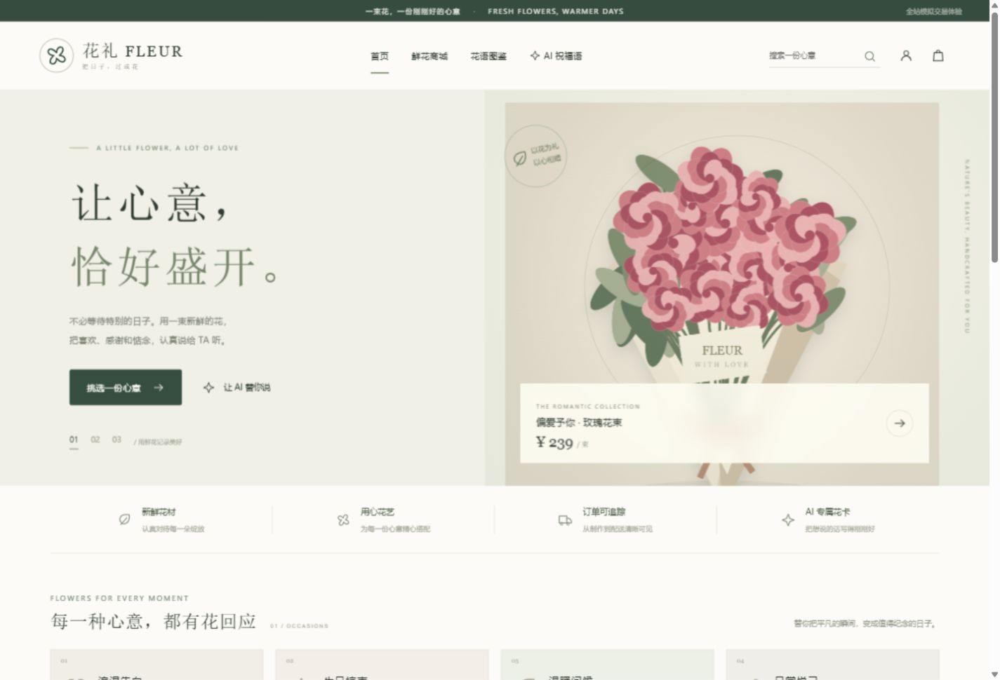
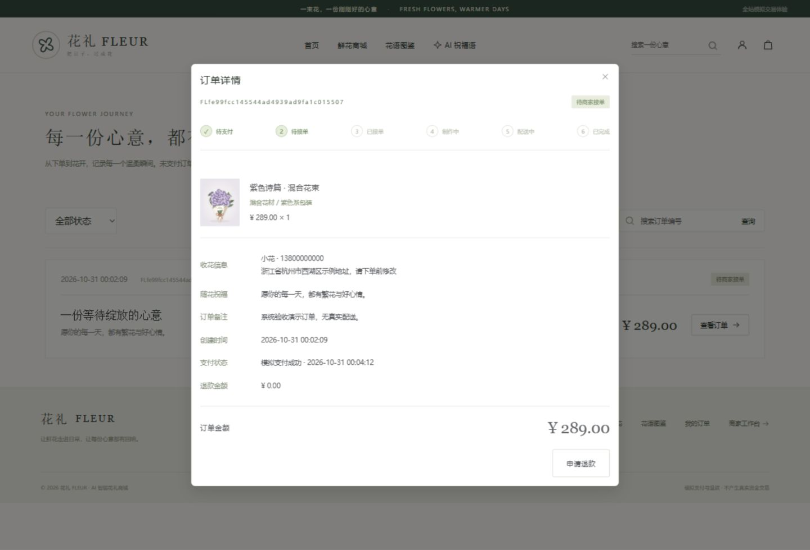
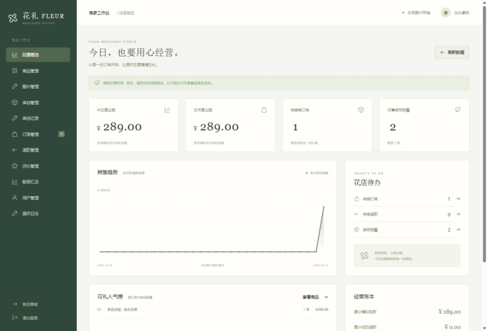
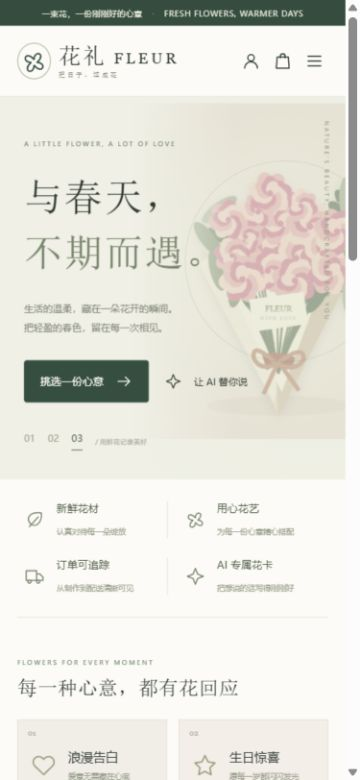

# 花礼 FLEUR · AI智能花礼商城

一个基于 Vue 3 与 Spring Boot 的鲜花商城项目，包含用户购物端和商家管理后台，支持鲜花选购、祝福语生成、订单履约、库存管理及经营统计。用户端与商家端均为中文，适配电脑和手机。

**技术栈：** Vue 3 · Vite · Pinia · Element Plus · Java 17 · Spring Boot · MyBatis · MySQL 8 / H2

页面字体、图标和演示花束插画由项目本地提供，运行时没有海外 CDN 依赖。祝福语默认使用本地模板，可配置外部 AI 服务；支付与退款使用模拟流程。

## 页面预览

以下为项目本地运行截图，页面中的订单与经营数据为演示数据。

### 商城首页

展示花束轮播、送花场景和商城入口。



### 订单详情

展示订单状态进度、商品明细、收花信息、花卡祝福语与模拟支付结果。



### 商家工作台

展示经营概览、销售趋势、待处理订单与库存预警，并提供商品、订单、退款等管理入口。



### 手机端适配

首页在手机宽度下的导航、花束轮播和场景入口。



## 本地运行（Windows）

从 GitHub 获取源码后，先构建，再启动：

1. 准备 Java 17+、Node.js 20.19+（或 22.12+）和 Maven 3.9+，确认命令已加入 PATH。
2. 双击项目根目录的 `build.cmd`，等待前后端构建完成。
3. 双击 `start-local.cmd`，等待看到 `Started FlowerApplication`。
4. 用户端打开 **http://127.0.0.1:8080/**，商家端打开 **http://127.0.0.1:8080/#/admin**。

`backend/target/` 不纳入版本管理，因此从 GitHub 下载的源码首次启动前需要构建。原始项目压缩包包含后端 JAR 和前端 dist，使用该压缩包时可直接运行 `start-local.cmd`；本地演示默认使用 H2，无需先安装 MySQL。

| 角色 | 本地演示账号 | 密码 |
|---|---|---|
| 普通用户 | demo | Demo123! |
| 商家管理员 | admin | Admin123! |

默认local配置使用 **H2文件数据库**，数据保存在 `backend/data/`，重启后仍保留；这是便于开箱体验的附加配置。**正式数据库按需求使用MySQL 8.0**，切换方式见[部署说明](docs/部署说明.md)。不要同时启动两个实例访问同一H2文件。

## 已实现

- 用户注册登录、JWT认证、BCrypt密码哈希、资料/头像/密码修改、收藏及地址管理。
- 首页轮播、商品分类与搜索、商品详情与图片、10种花卉花语及颜色文化信息。
- 祝福语生成、历史记录、编辑/复制/保存及关联订单；支持后端调用国内OpenAI兼容AI服务。
- 购物袋、地址确认、订单快照、模拟支付成功/失败、支付幂等、订单查询与取消。
- 商家商品新增编辑、上下架/逻辑删除、封面/详情图上传和排序、闲置图片清理。
- 可售库存入库/出库/校正、自定义预警、库存记录、并发原子扣减和事务回滚。
- 商家接单、制作、配送、完成与拒单退款；未支付订单30分钟超时释放库存。
- 用户部分/全额退款、商家审核、异步模拟退款、失败重试及退款限额校验。
- 已购买且完成订单的商品文字/星级/实拍图片评价，评价修改/删除、商家回复与有依据的隐藏/恢复。
- 今日/月/累计收款、退款与净收款、订单数、销售趋势、销售排行、评价统计、用户禁用/恢复及审核日志。

## AI与国内网络

未设置 `AI_API_KEY` 时使用**本地模板模式**，页面明确显示“本地模板”，不冒充已调用AI。设置后使用后端HTTP调用：

```powershell
$env:AI_BASE_URL = 'https://api.deepseek.com'
$env:AI_MODEL = 'deepseek-chat'
$env:AI_API_KEY = '你的服务密钥'
```

也可改为其他国内服务的OpenAI兼容地址与模型。`AI_BASE_URL` 指向兼容API根路径（例如服务要求 `/v1` 时需包含 `/v1`），代码自动追加 `/chat/completions`。Key仅在后端环境变量中读取。**交付时未提供真实密钥，因此外部AI服务实际调用尚未验证。**

开发依赖已配置国内源：npm使用 `registry.npmmirror.com`，Maven通过 `settings-cn.xml` 使用华为云镜像。两者已在当前环境完成安装/构建。镜像与AI服务的可用性仍以部署时运营商网络和服务商状态为准。

## 源码开发

前端：Vue 3 + Vite + JavaScript + Vue Router + Pinia + Axios，商家表格/弹窗等使用Element Plus；没有TypeScript源码。

后端：Java 17编译目标 + Spring Boot + MyBatis；生产MySQL 8.0，图片本地磁盘存储。金额使用DECIMAL/BigDecimal。

```powershell
# 后端，进入 backend
mvn.cmd -s settings-cn.xml spring-boot:run
# 前端另开终端，进入 frontend
npm.cmd ci
npm.cmd run dev
```

前端开发入口 http://127.0.0.1:5173/ ，通过Vite代理访问8080后端。

重新构建运行 `build.cmd`；测试在backend目录运行 `mvn.cmd -s settings-cn.xml test`。

## 项目结构

```text
frontend/       Vue源码、package-lock、dist生产构建、本地SVG插画
backend/        Java源码、配置、自动化测试；构建后在target生成可执行JAR
database/       MySQL建库、建表、基础/演示初始化、索引脚本
deploy/         Nginx、systemd服务及环境变量示例
docs/           API、部署、使用、业务规则、测试结果、页面截图、原始需求
start-local.cmd 本地演示启动
start-mysql.cmd MySQL模式启动
build.cmd       源码重新构建
```

完整操作见[使用说明](docs/使用说明.md)，业务约定见[支付退款与图片说明](docs/支付退款与图片说明.md)，验证范围见[测试报告](docs/测试报告.md)。

支付和退款均为模拟流程，不发生真实资金交易。演示商品图片为本地原创SVG插画，非真实商品照片；商家可上传实拍图替换。应用未发布到公网，也未接入真实物流或真实支付。
